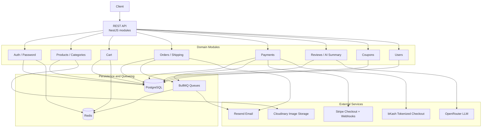
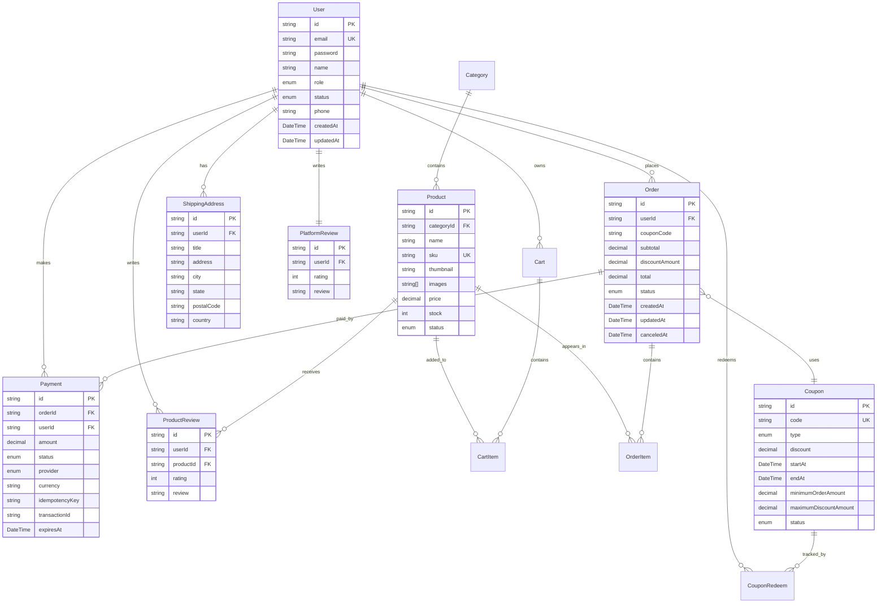
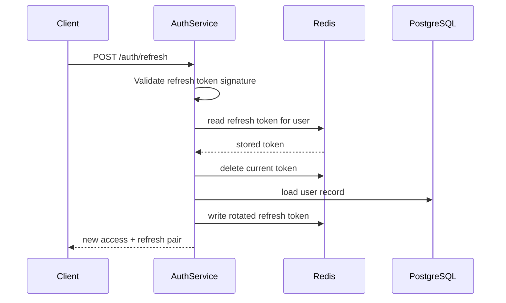
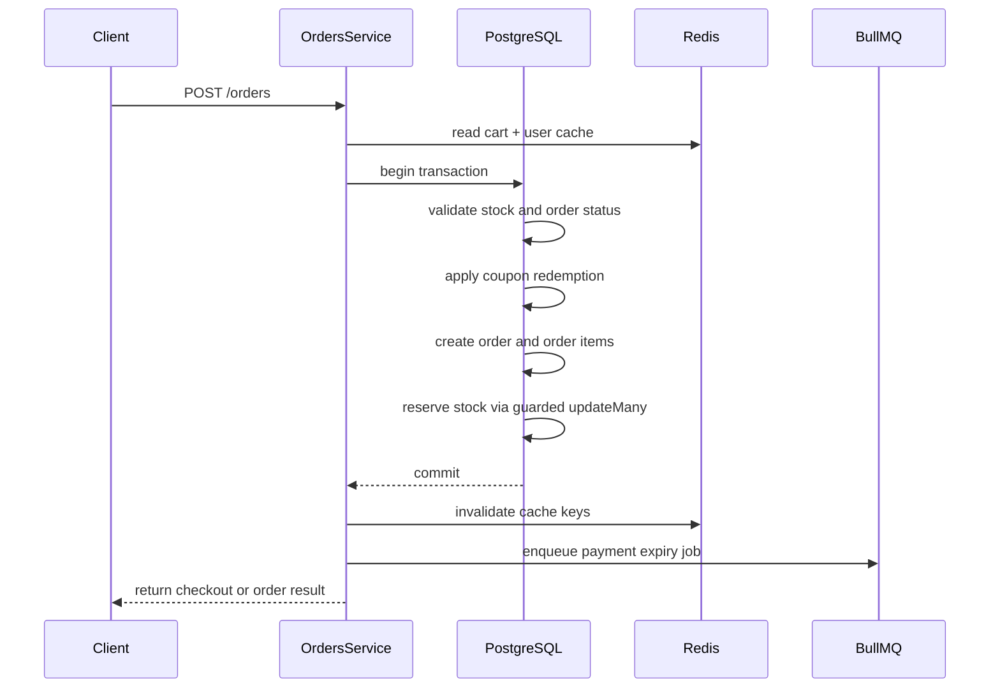
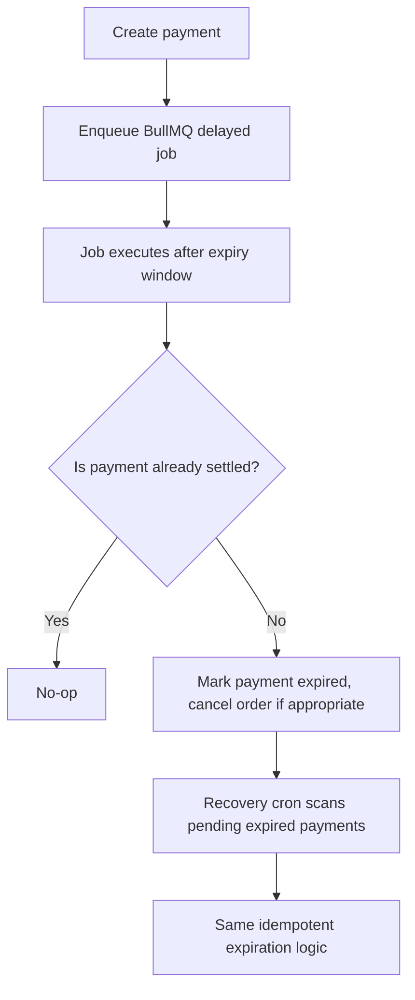
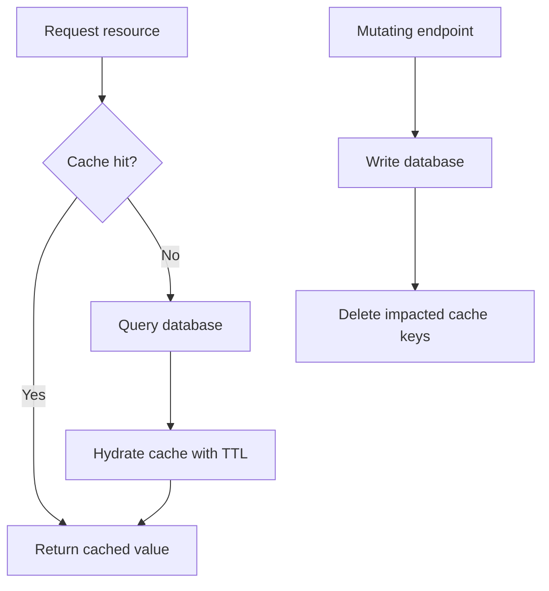
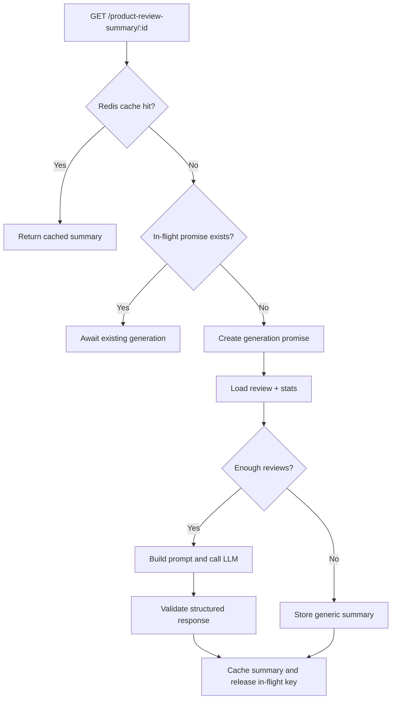

# Order Flow

Production-oriented e-commerce backend API for catalog, cart, order, payment, coupon, and review management built with NestJS, TypeScript, PostgreSQL, Prisma, Redis, BullMQ, and an LLM-assisted review summary pipeline.

<div align="center">
  <a href="https://github.com/habib33-3/order-flow/actions/workflows/build-push.yml"></a>
  <a href="https://github.com/habib33-3/order-flow/actions/workflows/db-migration.yml"></a>
  <a href="https://img.shields.io/badge/Node.js-24-339933?logo=node.js&logoColor=white"></a>
  <a href="https://img.shields.io/badge/TypeScript-6-3178C6?logo=typescript&logoColor=white"></a>
  <a href="https://img.shields.io/badge/PostgreSQL-17-4169E1?logo=postgresql&logoColor=white"></a>
  <a href="https://img.shields.io/badge/Prisma-7-2D3748?logo=prisma&logoColor=white"></a>
  <a href="https://img.shields.io/badge/Redis-7-DC382D?logo=redis&logoColor=white"></a>
  <a href="https://img.shields.io/badge/Docker-Compose-2496ED?logo=docker&logoColor=white"></a>
  <a href="https://img.shields.io/badge/License-MIT-green?logo=mit"></a>
</div>

<p align="center">
  <a href="https://github.com/habib33-3/order-flow">Repository</a> •
  <a href="https://order-flow-ek0n.onrender.com">Live API</a> •
  <a href="https://order-flow-ek0n.onrender.com/api/docs">Swagger Docs</a> •
  <a href="https://github.com/habib33-3/order-flow/issues">Issues</a>
</p>

## ✨ Overview

Order Flow is a backend-first commerce API designed for real-world concerns: authenticated user flows, transactional inventory control, provider-based payment orchestration, coupon enforcement, async notifications, and AI-assisted product review insights. The codebase follows production-oriented patterns such as Redis-backed caching, queue-driven background jobs, request throttling, and explicit validation at app startup.

The platform organizes work into domain modules for authentication, products, categories, carts, orders, shipping addresses, reviews, coupons, payments, and review-summary generation. The API is served under the `/api/v1` prefix and exposes Swagger docs at `/api/docs` for request/response inspection.

## ✨ Key Features

### Authentication and authorization

- Registration, login, JWT access/refresh flow, and refresh-token rotation.
- Password reset and OTP-based verification with Redis-backed expiry and cooldown checks.
- Role-aware access control with an application-level access token guard and account-scoped rate limits.

### Catalog and cart operations

- Product and category management with search, filtering, sorting, and catalog validation.
- Cart persistence per user with cache-aside reads and cache invalidation on every mutation.
- Shipping address management tied to the authenticated user.

### Orders and inventory reservation

- Single-transaction order creation with stock validation and inventory reservation.
- Coupon redemption inside the same transactional boundary, with post-commit cache invalidation.
- Order lifecycle tracking from pending state through processing, shipment, delivery, or cancellation.

### Payments and background processing

- Provider abstraction for Stripe and bKash tokenized checkout flows.
- Payment expiry handled by a delayed BullMQ job and a cron-based recovery sweep.
- Email jobs and queue-based processing wired through Redis-backed BullMQ workers.

### Reviews, insights, and AI summaries

- Product and platform review models with analytics aggregation.
- LLM-generated product review summaries with cache keys tied to prompt version.
- In-flight deduplication for concurrent requests and a safe fallback summary when review data is insufficient.

### Security and infrastructure

- Zod-based environment validation on boot.
- Helmet security headers, validation pipes, Redis-mediated throttling, and signed webhook verification.
- Dockerized local service composition with PostgreSQL and Redis, plus GitHub Actions workflows for build, linting, image publishing, and migration deployment.

## 🛠️ Tech Stack

| Category        | Technology                                      |
| --------------- | ----------------------------------------------- |
| Framework       | NestJS 12                                       |
| Language        | TypeScript 6                                    |
| Runtime         | Node.js 24                                      |
| Database        | PostgreSQL 17                                   |
| ORM             | Prisma 7 + `@prisma/adapter-pg`                 |
| Cache           | Redis via `ioredis`                             |
| Queue           | BullMQ 6 + `@nestjs/bullmq`                     |
| Auth            | `@nestjs/passport`, `passport-jwt`, `argon2`    |
| Payments        | Stripe (`stripe` 22) + bKash Tokenized Checkout |
| Email           | Resend + Handlebars templates                   |
| Image Storage   | Cloudinary                                      |
| LLM             | LangChain + `@langchain/openai` via OpenRouter  |
| Validation      | `class-validator` + Zod                         |
| Security        | Helmet, `@nestjs/throttler`                     |
| Package Manager | pnpm 12.4.2                                     |
| Containers      | Docker + Docker Compose                         |
| Observability   | `@nestjs/observe`                               |

## 🏗️ Architecture



The application uses PostgreSQL as the source of truth for transactional domain data. Redis is used for cache entries, refresh-token persistence, rate-limit state, and BullMQ backing storage. BullMQ workers handle delayed payment expiry and transactional notifications without blocking the request path. Stripe, bKash, Cloudinary, Resend, and OpenRouter are treated as external providers behind isolated service boundaries and injected through NestJS modules.

## 🗄️ Database Schema



The Prisma schema is split into domain files under `prisma/schema/` and supports the main e-commerce relationships: users, products, categories, carts, orders, payments, coupons, reviews, and profile/addresses. The stack keeps the order lifecycle, payment state, and review data in PostgreSQL while leaving cache and queue state in Redis.

## 🔄 Important Engineering Workflows

### Authentication and refresh-token rotation



Refresh-token rotation is enforced by comparing the caller-provided token to the Redis value for the user. The old token is deleted before a new pair is issued; a replayed token is therefore rejected. This reduces the chance of token theft and replay abuse while preserving stateless JWT validation for access tokens.

### Order creation and inventory reservation



This flow keeps validation, coupon application, order creation, and stock decrement in one transactional block. A guarded stock update prevents overselling if another request reduces the same inventory concurrently. The transaction rolls back if the invariant fails.

### Payment expiry and recovery



The project uses a delayed BullMQ job plus a periodic recovery sweep. The duplication is intentional: a delayed job covers normal lifecycle expiry, while the scheduler catches jobs lost to Redis or worker interruptions. Both paths reuse the same transactional expiration logic to avoid double-expiration.

### Cache-aside and explicit invalidation



The app favors cache-aside reads: it checks Redis first and populates on a miss. Mutations do not rely on write-through updates; instead, they explicitly remove stale keys after a successful write to keep invalidation deterministic.

### AI review summary generation



The LLM summary path validates cached payloads with Zod, deduplicates concurrent requests in-process, and falls back to a generic summary when reviews are sparse or the provider fails. The key includes the prompt version, so a prompt change automatically invalidates prior cached summaries.

## 📁 Project Structure

```text
order-flow-backend/
├── .github/
│   └── workflows/
│       ├── build-push.yml
│       └── db-migration.yml
├── prisma/
│   ├── migrations/
│   ├── schema/
│   └── seed/
├── src/
│   ├── common/
│   │   ├── email/
│   │   ├── env/
│   │   ├── filters/
│   │   ├── guards/
│   │   ├── llm/
│   │   ├── prisma/
│   │   ├── queue/
│   │   ├── rate-limit/
│   │   ├── redis/
│   │   ├── swagger/
│   │   └── upload-file/
│   ├── generated/
│   ├── jobs/
│   ├── modules/
│   │   ├── auth/
│   │   ├── cart/
│   │   ├── category/
│   │   ├── coupon/
│   │   ├── orders/
│   │   ├── payment/
│   │   ├── product-review-summary/
│   │   ├── products/
│   │   ├── review/
│   │   ├── shipping-address/
│   │   └── user/
│   ├── types/
│   ├── app.module.ts
│   ├── app.controller.ts
│   └── main.ts
├── .env.example
├── .env.docker
├── .gitignore
├── Dockerfile
├── compose.yml
├── LICENSE
├── package.json
├── pnpm-lock.yaml
├── pnpm-workspace.yaml
├── prisma.config.ts
├── README.md
└── tsconfig*.json
```

## 🚀 Getting Started

### Prerequisites

- Node.js 24+
- pnpm 12.4.2+
- PostgreSQL 17+
- Redis 7+

You can also use Docker Compose for local Postgres and Redis instead of installing them separately.

### 1. Clone and install

```bash
git clone https://github.com/habib33-3/order-flow.git
cd order-flow
pnpm install
```

`pnpm install` triggers Prisma generation through the `postinstall` script.

### 2. Create environment files

```bash
cp .env.example .env
```

Copy the example values and fill in credentials for the PostgreSQL, Redis, JWT, Stripe, bKash, Resend, Cloudinary, OpenRouter, and Observe integrations. See the environment section below for the full reference.

### 3. Apply Prisma migrations

```bash
pnpm prisma migrate dev
```

### 4. Seed demo data (optional)

```bash
pnpm prisma db seed
```

### 5. Run the API locally

```bash
pnpm start:dev
```

The application listens on `http://localhost:5000` and mounts the API under `/api/v1`. Swagger is available at `http://localhost:5000/api/docs`.

## 🐳 Docker

The repository includes a Compose stack with three services: the NestJS API, PostgreSQL, and Redis. The container uses the local `db` and `redis` service names as hostnames.

### 1. Prepare the Docker environment file

```bash
cp .env.example .env.docker
```

Update `.env.docker` so the service hostnames match Compose:

```env
DATABASE_URL=postgresql://postgres:root@db:5432/raco-ai-db?schema=public
REDIS_URL=redis://redis:6379
SERVER_URL=http://localhost:5000
```

The Compose database service also expects `POSTGRES_USER`, `POSTGRES_PASSWORD`, and `POSTGRES_DB` to be defined in the environment file because the Postgres image reads them at startup.

### 2. Build and start

```bash
docker compose up --build
```

### 3. Apply migrations inside the running API container

```bash
docker compose exec app pnpm prisma migrate deploy
```

### 4. Optional seed

```bash
docker compose exec app pnpm prisma db seed
```

### 5. Access points

- API: `http://localhost:5000/api/v1`
- Swagger: `http://localhost:5000/api/docs`
- Bull Board: `http://localhost:5000/queues` when `SHOW_BULL_BOARD=true`

### 6. Stop and clean up

```bash
docker compose down
# or, for a full reset
# docker compose down -v
```

`docker compose down` stops the containers while keeping volumes; `-v` removes persistent data.

## 🔐 Environment Variables

The application validates environment variables at startup with Zod. Required values are enforced by the server config; optional variables include defaults.

> Note: `STRIPE_PUBLIC_KEY` appears in `.env.example` but is not required by the server-side validation schema used by `src/common/env/env.ts`.

| Variable                      | Required | Default                 | Purpose                                  |
| ----------------------------- | -------- | ----------------------- | ---------------------------------------- |
| `DATABASE_URL`                | Yes      | —                       | PostgreSQL connection string             |
| `REDIS_URL`                   | Yes      | —                       | Redis connection string                  |
| `SERVER_URL`                  | Yes      | —                       | Public API base URL                      |
| `NODE_ENV`                    | No       | `development`           | Runtime environment                      |
| `PORT`                        | No       | `5000`                  | HTTP listen port                         |
| `CLIENT_URL`                  | No       | `http://localhost:3000` | Front-end base URL                       |
| `APP_NAME`                    | No       | `OrderFlow`             | Prefix used in cache key naming          |
| `EMAIL_FROM_EMAIL`            | Yes      | —                       | From address for transactional email     |
| `ACCESS_TOKEN_SECRET`         | Yes      | —                       | Access token signing secret              |
| `ACCESS_TOKEN_EXPIRES`        | No       | `12h`                   | Access token lifetime                    |
| `REFRESH_TOKEN_SECRET`        | Yes      | —                       | Refresh token signing secret             |
| `REFRESH_TOKEN_EXPIRES`       | No       | `7d`                    | Refresh token lifetime                   |
| `PASSWORD_RESET_TOKEN_SECRET` | Yes      | —                       | Password reset token secret              |
| `STRIPE_SECRET_KEY`           | Yes      | —                       | Stripe secret key                        |
| `STRIPE_WEBHOOK_SECRET`       | Yes      | —                       | Stripe webhook signature secret          |
| `STRIPE_PUBLIC_KEY`           | No       | —                       | Public key for client-side Stripe use    |
| `BKASH_BASE_URL`              | Yes      | —                       | bKash sandbox or production API base URL |
| `BKASH_USERNAME`              | Yes      | —                       | bKash username                           |
| `BKASH_PASSWORD`              | Yes      | —                       | bKash password                           |
| `BKASH_APP_KEY`               | Yes      | —                       | bKash app key                            |
| `BKASH_APP_SECRET`            | Yes      | —                       | bKash app secret                         |
| `RESEND_API_KEY`              | Yes      | —                       | Resend API key                           |
| `CLOUDINARY_CLOUD_NAME`       | Yes      | —                       | Cloudinary cloud name                    |
| `CLOUDINARY_API_KEY`          | Yes      | —                       | Cloudinary API key                       |
| `CLOUDINARY_API_SECRET`       | Yes      | —                       | Cloudinary API secret                    |
| `SHOW_BULL_BOARD`             | No       | `false`                 | Enables or disables the Bull Board route |
| `OBSERVE_APP_KEY`             | Yes      | —                       | `@nestjs/observe` app key                |
| `OBSERVE_APP_SECRET`          | Yes      | —                       | `@nestjs/observe` secret                 |
| `OPENROUTER_API_KEY`          | Yes      | —                       | OpenRouter API key                       |
| `OPENROUTER_MODEL`            | Yes      | —                       | Model string used for prompt generation  |

## 📋 Commands Reference

| Command                                              | Purpose                                            |
| ---------------------------------------------------- | -------------------------------------------------- |
| `pnpm install`                                       | Install dependencies and generate Prisma client    |
| `pnpm start`                                         | Start NestJS in normal mode                        |
| `pnpm start:dev`                                     | Start with live-reload watch mode                  |
| `pnpm start:debug`                                   | Start with debug mode and watch mode               |
| `pnpm build`                                         | Compile the TypeScript application                 |
| `pnpm start:prod`                                    | Run the built application from `dist/`             |
| `pnpm lint`                                          | Run ESLint                                         |
| `pnpm lint:fix`                                      | Auto-fix lint errors                               |
| `pnpm format`                                        | Run Prettier across source and test files          |
| `pnpm test`                                          | Run Jest unit tests                                |
| `pnpm test:watch`                                    | Run Jest in watch mode                             |
| `pnpm test:cov`                                      | Run Jest with coverage                             |
| `pnpm test:e2e`                                      | Run end-to-end Jest tests                          |
| `pnpm prisma migrate dev`                            | Apply local Prisma migrations                      |
| `pnpm prisma migrate deploy`                         | Apply migrations for deployment                    |
| `pnpm prisma db seed`                                | Seed demo data                                     |
| `pnpm seed`                                          | Run the repository seed entry point                |
| `docker compose up --build`                          | Build and start Postgres, Redis, and API container |
| `docker compose exec app pnpm prisma migrate deploy` | Apply migrations in the containerized app          |
| `docker compose down`                                | Stop containers while keeping volumes              |
| `docker compose down -v`                             | Stop containers and remove persistent volumes      |

## ⚙️ CI/CD

The repository includes two GitHub Actions workflows.

### `build-push.yml`

- Triggered on `push` and `pull_request` events for the `main` branch.
- Installs dependencies with pnpm, then runs the application build and ESLint.
- On pushes to `main`, builds and pushes a Docker image to Docker Hub and triggers a Render deployment hook.
- The workflow does not run the Jest suite.

### `db-migration.yml`

- Triggered on pushes to `main` when migration files, Prisma schema files, or Prisma config files change.
- Installs dependencies without running lifecycle scripts, then executes `pnpm prisma migrate deploy` against the configured Neon database URL.
- This workflow covers schema rollouts separately from the application build and deployment pipeline.

## 🛡️ Security

| Area              | Implemented control                                                                        |
| ----------------- | ------------------------------------------------------------------------------------------ |
| Passwords         | Argon2 hashing and verification for user credentials                                       |
| OTPs              | Argon2-hashed verification codes with Redis expiry and resend throttling                   |
| JWTs              | Separate access, refresh, and password-reset secrets with refresh-token rotation           |
| Authorization     | Global access-token guard with role-aware enforcement for protected routes                 |
| Input validation  | `ValidationPipe` with `whitelist` and `forbidNonWhitelisted`, plus DTO validation          |
| HTTP hardening    | Helmet middleware enabled in the Nest bootstrap                                            |
| Webhook integrity | Stripe webhook event verification via signature validation                                 |
| Rate limiting     | Redis-backed throttler with account-scoped and IP-based limits                             |
| LLM safety        | Prompt injection guard around untrusted review text; structured output validation with Zod |
| Config safety     | Startup validation with Zod prevents booting with missing or malformed env values          |

## 🗺️ Roadmap and Future Improvements

- Add stronger end-to-end coverage for auth, carts, orders, payments, and webhook handling.
- Move LLM deduplication to a distributed lock so concurrent requests across multiple app instances share the same in-flight guard.
- Expand observability dashboards and SLO-aware health metrics for queue lag and payment lifecycle drift.
- Tighten payment retry logic and idempotency auditing for provider edge cases.
- Add audit trails and soft-deletion patterns for admin operations and customer-facing updates.
- Consider a dedicated background worker/audit service for long-running analytics and review summary generation.

## 📄 License

This project is licensed under the [MIT License](License).
