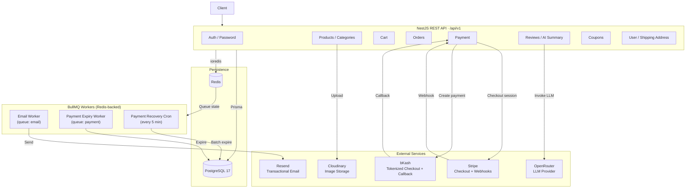

# Phase 3 — Architecture and Database

## System Architecture Diagram



### Design Notes

- **PostgreSQL** is the authoritative store for all domain data: users, products, carts, orders, payments, coupons, reviews, and shipping addresses.
- **Redis** serves three roles: cache store (cache-aside pattern), refresh-token store, and BullMQ backing store for queue metadata and delayed jobs.
- **BullMQ** uses the same Redis instance. Job options are centrally configured (3 attempts, exponential backoff, completed/failed retention).
- **Provider integrations** (Stripe, bKash, Cloudinary, Resend, OpenRouter) are isolated in dedicated modules, accessed through NestJS dependency injection.
- The **payment module** uses a strategy pattern: `getStrategy(provider)` returns either `StripeStrategy` or `BkashStrategy`. No payment provider logic leaks into order processing.

## ER Diagram

Generated from `prisma/schema/*.prisma`.

```mermaid
erDiagram
    User {
        String id PK
        String email UK
        String name
        String password
        UserRole role
        UserStatus status
        String phone
        String avatarUrl
        DateTime createdAt
        DateTime updatedAt
        DateTime lastLoginAt
    }
    Category {
        String id PK
        String name UK
        String description
        String logo
    }
    Product {
        String id PK
        String name
        String sku UK
        String thumbnail
        String[] images
        String description
        Decimal price
        Int stock
        ProductStatus status
        String categoryId FK
    }
    Cart {
        String id PK
        String userId FK UK
    }
    CartItem {
        String id PK
        String cartId FK
        String productId FK
        Int quantity
    }
    Order {
        String id PK
        String userId FK
        Decimal subtotal
        Decimal discountAmount
        Decimal total
        OrderStatus status
        String shippingAddress
        String couponId FK
        String couponCode
        String note
        DateTime paidAt
        DateTime canceledAt
    }
    OrderItem {
        String id PK
        String orderId FK
        String productId FK
        Int quantity
        Decimal unitPrice
        Decimal subtotal
    }
    Payment {
        String id PK
        String orderId FK
        String userId FK
        Decimal amount
        PaymentStatus status
        PaymentProvider provider
        String currency
        String idempotencyKey
        String transactionId
        DateTime expiresAt
    }
    Coupon {
        String id PK
        String code UK
        CouponType type
        Decimal discount
        DateTime startAt
        DateTime endAt
        Decimal minimumOrderAmount
        Decimal maximumDiscountAmount
        CouponStatus status
        Int maxLimit
        Int remainingLimit
        Int maxLimitPerUser
    }
    CouponRedeem {
        String id PK
        String userId FK
        String couponId FK
    }
    ShippingAddress {
        String id PK
        String userId FK
        String title
        String address
        String city
        String state
        String postalCode
        String country
    }
    ProductReview {
        String id PK
        String userId FK
        String productId FK
        Int rating
        String review
    }
    PlatformReview {
        String id PK
        String userId FK UK
        Int rating
        String review
    }

    User ||--o{ Order : "places"
    User ||--o{ Payment : "makes"
    User ||--o{ Cart : "has"
    User ||--o{ ShippingAddress : "has"
    User ||--o{ CouponRedeem : "redeems"
    User ||--o{ ProductReview : "writes"
    User ||--|| PlatformReview : "writes"

    Category ||--o{ Product : "contains"

    Product ||--o{ OrderItem : "appears in"
    Product ||--o{ CartItem : "added to"
    Product ||--o{ ProductReview : "receives"

    Cart ||--o{ CartItem : "contains"

    Order ||--o{ OrderItem : "contains"
    Order ||--o{ Payment : "paid by"
    Order }o--|| Coupon : "uses"

    Coupon ||--o{ CouponRedeem : "tracked by"
```

### Key Constraints and Indexes

| Table              | Constraint                                                                                              |
| ------------------ | ------------------------------------------------------------------------------------------------------- |
| `users`            | `email` UNIQUE; index on `role`                                                                         |
| `products`         | `sku` UNIQUE; index on `status`                                                                         |
| `carts`            | `userId` UNIQUE (one cart per user)                                                                     |
| `cart_items`       | UNIQUE `(cartId, productId)`                                                                            |
| `order_items`      | UNIQUE `(orderId, productId)`                                                                           |
| `payments`         | UNIQUE `(provider, idempotencyKey)`; UNIQUE `(provider, transactionId)`; index on `(status, expiresAt)` |
| `orders`           | index on `userId`, index on `status`                                                                    |
| `coupon_redeems`   | index on `couponId`, `userId`, `(couponId, userId)`                                                     |
| `product_reviews`  | UNIQUE `(userId, productId)`; index on `productId`                                                      |
| `platform_reviews` | `userId` UNIQUE (one per user)                                                                          |

## Project Structure

```text
order-flow-backend/
├── prisma/
│   ├── schema/                  # Split schema files (one per domain model)
│   │   ├── schema.prisma        # Generator and datasource config
│   │   ├── user.prisma
│   │   ├── product.prisma
│   │   ├── category.prisma
│   │   ├── cart.prisma
│   │   ├── order.prisma
│   │   ├── payment.prisma
│   │   ├── coupon.prisma
│   │   ├── review.prisma
│   │   └── shipping-address.prisma
│   ├── migrations/              # Prisma migration history
│   └── seed/                    # Seed data scripts
│
├── src/
│   ├── common/                  # Shared infrastructure
│   │   ├── email/               # Resend email + Handlebars templates
│   │   ├── env/                 # Zod env validation (env.ts)
│   │   ├── filters/             # Global exception filter
│   │   ├── guards/              # Admin guard
│   │   ├── llm/                 # LangChain / OpenRouter service
│   │   ├── prisma/              # PrismaService with pg adapter
│   │   ├── queue/               # BullMQ setup, Bull Board, base processor
│   │   ├── redis/               # RedisService (ioredis), cache-key helpers
│   │   ├── swagger/             # Swagger configuration
│   │   └── upload-file/         # Cloudinary upload service
│   │
│   ├── jobs/                    # Scheduled cron jobs
│   │   └── expire-payment.cron.service.ts
│   │
│   ├── modules/                 # Domain feature modules
│   │   ├── auth/
│   │   │   ├── auth/            # Register, login, OTP, refresh, logout
│   │   │   └── password/        # Forgot/reset password
│   │   ├── cart/
│   │   ├── category/
│   │   ├── coupon/
│   │   │   ├── coupon/          # Coupon CRUD + redemption
│   │   │   └── coupon-analytics/
│   │   ├── orders/              # Order creation, lifecycle, cancellation
│   │   ├── payment/
│   │   │   ├── bkash/           # bKash strategy + callback controller
│   │   │   ├── stripe/          # Stripe strategy + webhook controller
│   │   │   ├── strategies/      # Payment strategy interface
│   │   │   └── job/             # BullMQ payment queue service + processor
│   │   ├── product-review-summary/  # AI summary (LLM + cache + dedup)
│   │   ├── products/
│   │   ├── review/
│   │   │   ├── platform-review/ # Platform reviews + analytics
│   │   │   └── product-review/  # Product reviews + analytics
│   │   ├── shipping-address/
│   │   └── user/
│   │
│   ├── generated/               # Prisma Client output
│   ├── types/                   # Shared TypeScript types (JwtPayload, etc.)
│   ├── app.module.ts
│   └── main.ts
│
├── .github/workflows/
│   ├── build-push.yml           # CI: build, lint, Docker push, Render deploy
│   └── db-migration.yml         # CD: Prisma migrate deploy to Neon
│
├── Dockerfile                   # Multi-stage production build
├── compose.yml                  # Local dev stack (API + Postgres + Redis)
└── .env.example                 # Environment variable reference
```
