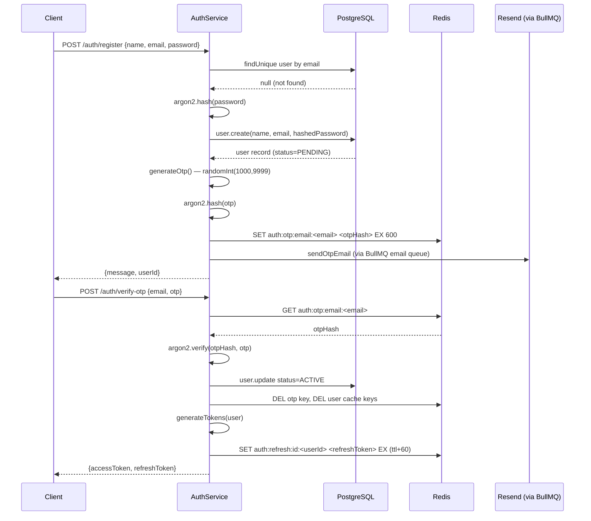
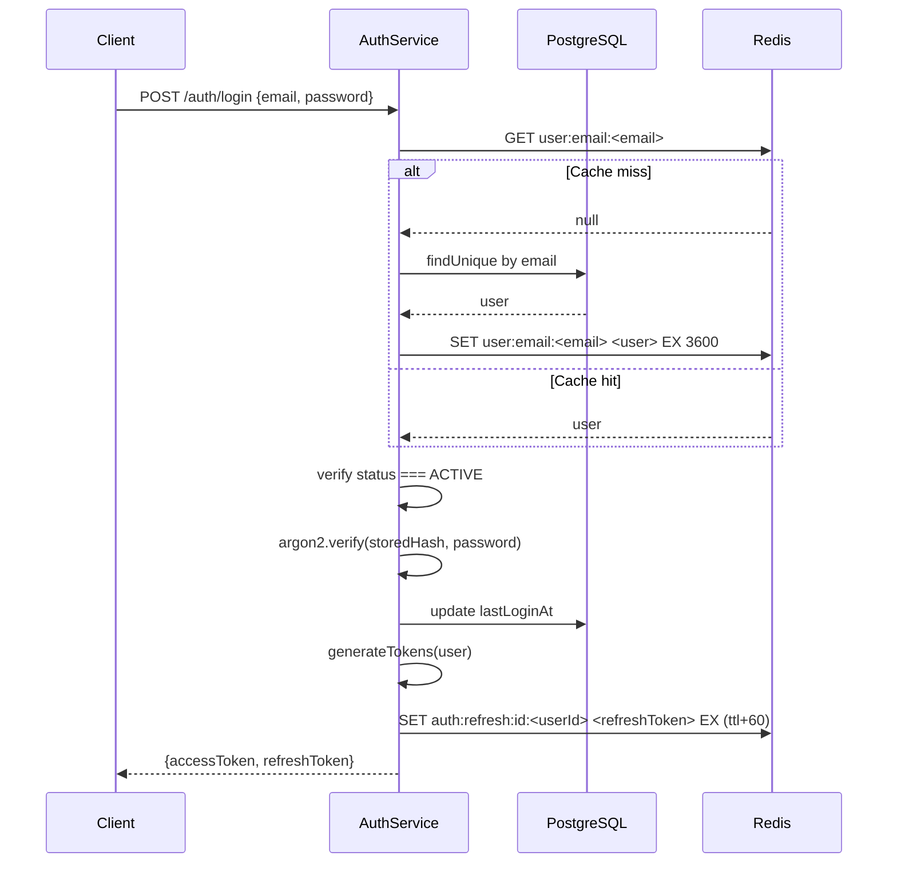
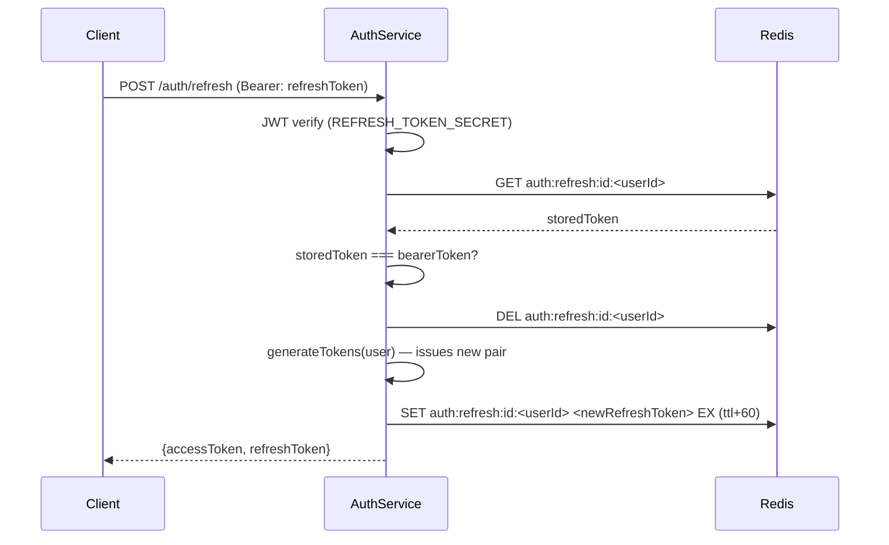
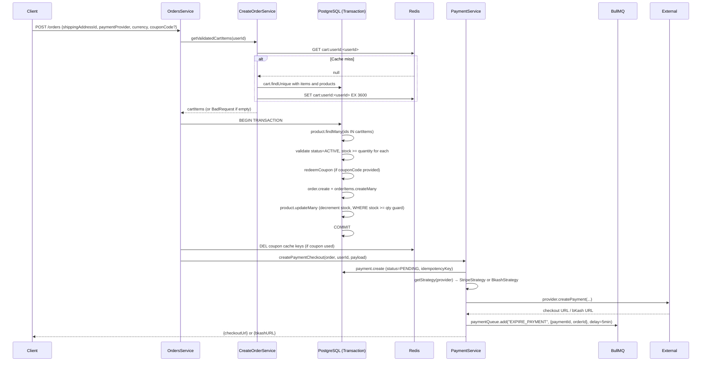
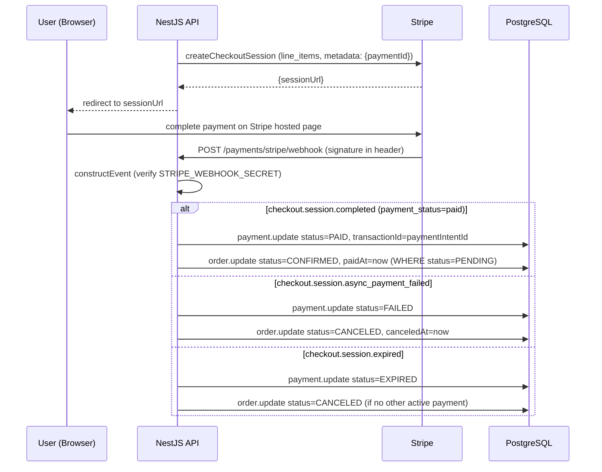
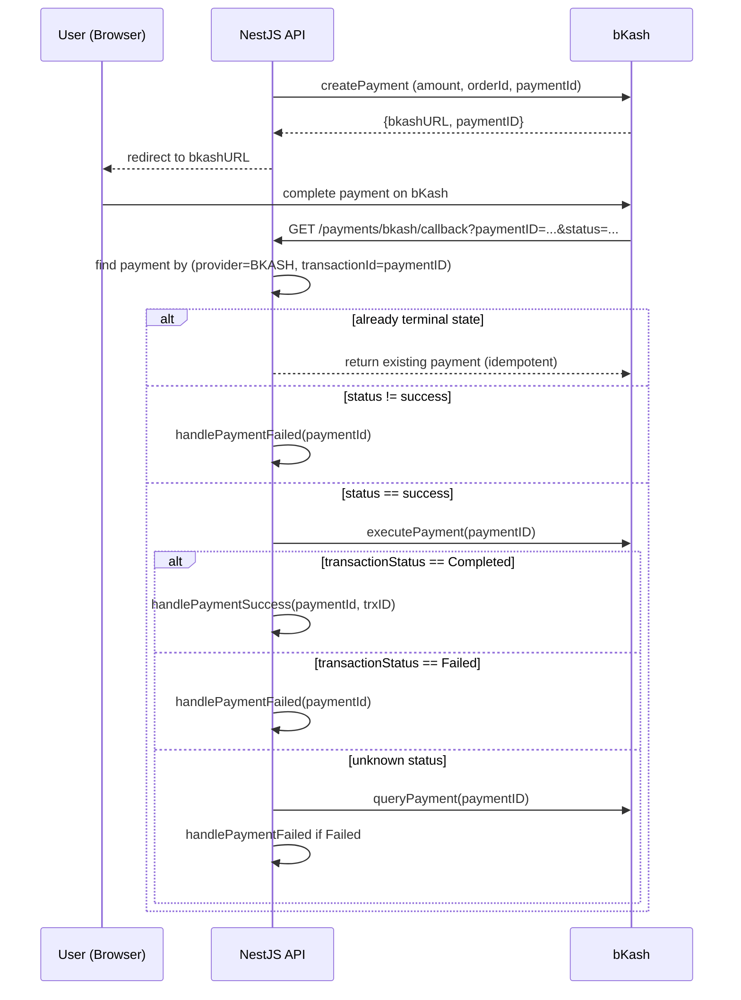
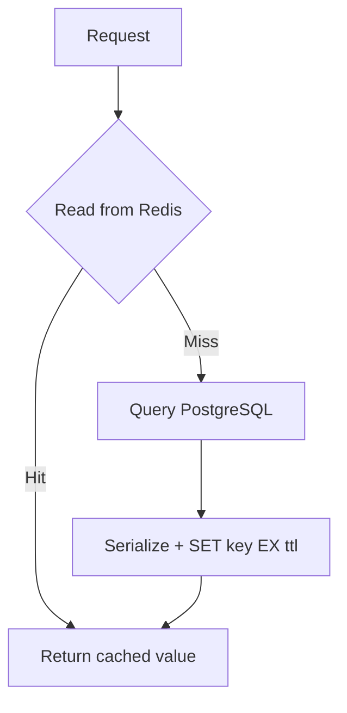

# Phase 4 — Workflows and Caching

## Authentication Flow

### Registration and Email Verification



### Login



### Refresh Token Rotation



The old refresh token is deleted before the new one is issued. Replaying the old token returns 401 because it no longer exists in Redis.

---

## Order Creation and Inventory Reservation



### Stock Reservation Safety

The transaction performs `product.updateMany` with a `WHERE stock >= quantity` guard. If stock has been concurrently decremented by another request between the read and the update, the `count === 0` result causes the transaction to throw `BadRequestException`, which rolls back the entire order. This prevents overselling without requiring a separate locking mechanism.

---

## Payment Lifecycle

### Stripe Payment



### bKash Payment



### Payment Expiry — Two Layers

**Layer 1 — BullMQ delayed job:**
When a payment is created, a BullMQ job is enqueued with a 5-minute delay:

```
jobId: expire-payment:<paymentId>
delay: 300000 ms
```

The processor calls `PaymentService.expirePayment(paymentId, orderId)`, which:

1. Runs `payment.updateMany(WHERE status=PENDING AND expiresAt <= now)` — idempotent
2. If another payment for the same order is still PENDING or PAID, does not cancel the order
3. Otherwise, sets order status to CANCELED

**Layer 2 — Recovery cron (every 5 minutes):**
`ExpirePaymentJobService.expirePayments()` processes `PENDING` payments where `expiresAt < now` in batches of 100. Each payment uses the same transactional logic. This catches any jobs lost between Redis restarts or worker crashes.

---

## Caching

### Cache Key Structure

All keys are prefixed with `${APP_NAME}-cache:` and follow the pattern:

```
<APP_NAME>-cache:<domain>:<sub-domain>:<qualifier>...
```

Examples:

```
order-flow-cache:user:id:<userId>
order-flow-cache:user:email:<email>
order-flow-cache:cart:userId:<userId>
order-flow-cache:product:id:<productId>
order-flow-cache:product:list:<search>:<cursor>:<limit>:<status>:<sort>:<sortBy>:<categoryId>
order-flow-cache:coupon:code:<code>
order-flow-cache:auth:refresh:id:<userId>
order-flow-cache:auth:otp:email:<email>
order-flow-cache:auth:otp:resend:<email>
order-flow-cache:llm:product-review:summary:<promptVersion>:<productId>
```

### Cache-Aside Pattern (Standard Resources)



**Default TTL:** 3600 seconds (1 hour) for most resources. No per-resource override for standard entities — TTL is the `redis.set` default.

**Invalidation:** On any mutation (create, update, delete), the relevant key(s) are explicitly deleted:

```
redis.delete(cartCacheKeyWithUserId(userId))
redis.delete(productCacheKeyWithId(id))
redis.delete(couponCacheKeyWithCode(code))
// etc.
```

There is no write-through caching. There is no cache-level locking or Redlock. Concurrent requests that miss the cache may each hit the database; the last `SET` wins.

### OTP Rate Limiting via Redis SET NX

OTP resend cooldown uses `redis.setIfNotExists(key, "1", 60)` which maps to `SET key 1 EX 60 NX`. If the key already exists (set within the last 60 seconds), the operation returns `false` and the handler returns HTTP 429. The resend key is deleted on failure (OTP hash + resend key) to prevent lock-out if email delivery fails.

### AI Review Summary — Separate Cache Behaviour

```mermaid
flowchart TD
    A["GET /products/:id/review-summary"] --> B{Read Redis\nllm:product-review:summary:v1:<id>}
    B -->|Hit, valid Zod| C[Return cached]
    B -->|Miss or invalid| D{In-flight Map\ninFlight.get(key)?}
    D -->|Promise exists| E[Await existing promise\nshared result]
    D -->|No promise| F[Set inFlight.set(key, promise)]
    F --> G[Load reviews (up to 100) + stats from DB]
    G --> H{totalReviewCount >= 3?}
    H -->|No| I[Cache GENERIC_REVIEW_SUMMARY\nwith SUMMARY_TTL]
    H -->|Yes| J[Build prompt with XML-escaped reviews]
    J --> K[ChatOpenAI.invoke via OpenRouter\nstructured output: ProductReviewSummarySchema]
    K --> L[Cache result EX 43200]
    L --> M[inFlight.delete(key)]
    M --> C
    I --> M
```

**Key differences from standard caching:**

- TTL is 43200 s (12 h) vs 3600 s default
- The key includes `promptVersion` (`v1`) — changing the prompt version auto-invalidates all existing summaries
- In-flight deduplication is in-process only (not distributed); multiple API instances would each make their own LLM call
- Cache read validates against Zod schema; a corrupted/stale entry is treated as a miss
- All LLM errors and DB errors fall back to `GENERIC_REVIEW_SUMMARY` (never throws to the client)
